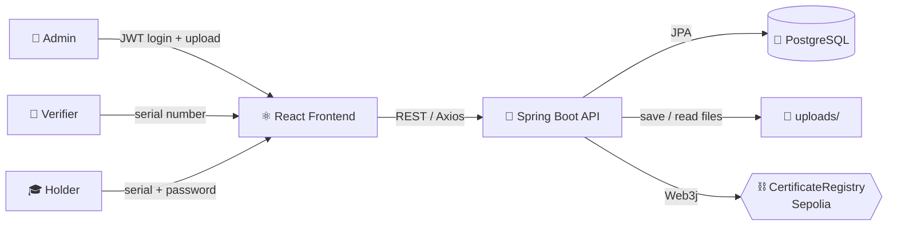
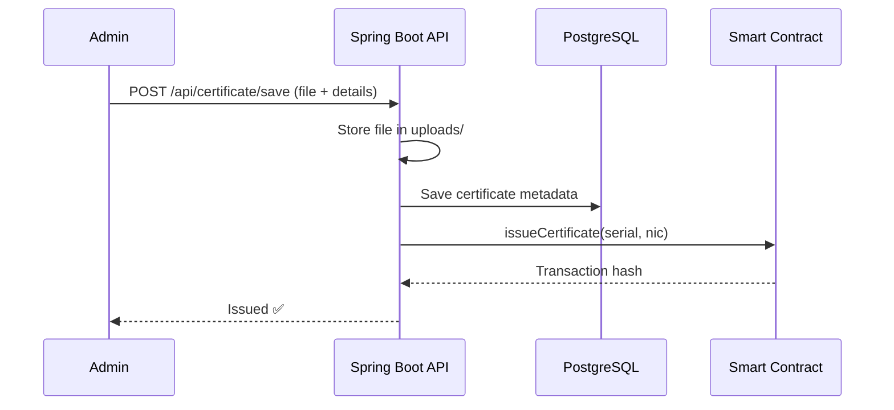

<div align="center">

# 🎓 Certificate Authenticator

### Tamper-proof certificates, verified on the blockchain.

Issue academic certificates, record them on an Ethereum smart contract, and let anyone verify them in seconds.

<br/>


[Features](#-features) · [Architecture](#-architecture) · [Quick Start](#-quick-start) · [API](#-api-reference) · [Security](#-security-notes)

</div>

---

## ✨ Features

| | |
|---|---|
| 🔍 **Instant verification** | Anyone can check a certificate's validity by serial number, with the answer read straight from the blockchain. |
| ⛓️ **On-chain proof** | Every issued certificate is written to a Solidity smart contract through Web3j, so records can't be quietly altered. |
| 🔐 **Admin portal** | JWT-secured login and an issuing dashboard with file upload and student details. |
| 📥 **Protected downloads** | Certificate holders retrieve their file using their serial number and a password. |
| 🎨 **Modern UI** | A glassmorphism interface with smooth page transitions and toast notifications. |
| 🗄️ **Hybrid storage** | Metadata lives in PostgreSQL and files on disk, while integrity proof lives on-chain. |

## 🏗️ Architecture



**Issuing flow**



## 🧰 Tech Stack

<table>
<tr>
<td valign="top" width="33%">

**Backend**
- Java 21
- Spring Boot 3.5
- Spring Security + JWT (jjwt)
- Spring Data JPA
- Web3j
- Maven

</td>
<td valign="top" width="33%">

**Frontend**
- React 18 + TypeScript
- Vite
- Tailwind CSS
- Framer Motion
- React Router
- Axios + Sonner

</td>
<td valign="top" width="33%">

**Data and Chain**
- PostgreSQL
- Solidity ^0.8.0
- Ethereum Sepolia
- Infura (RPC)

</td>
</tr>
</table>

## 📁 Project Structure

```text
CertificateAuthenticator/
├── Certificate_Authenticator_Backend/     🍃 Spring Boot API
│   ├── src/main/java/.../Conroller/       REST controllers (auth, certificates)
│   ├── src/main/java/.../security/        JWT filter + utilities
│   ├── src/main/java/.../service/         Business logic
│   ├── src/main/java/.../util/            Web3j + file storage helpers
│   └── Solidity.txt                       CertificateRegistry smart contract
└── Certificate_Authenticator_Frontend/    ⚛️ React SPA
    └── src/
        ├── pages/                         Verify · Download · Admin Login · Admin Issue
        ├── components/                    UI kit + ProtectedRoute
        ├── context/                       Auth state
        └── services/api.ts                Backend client
```

## 🚀 Quick Start

### Prerequisites

- ☕ JDK 21+
- 🟢 Node.js 18+
- 🐘 PostgreSQL with a database named `CertificateAuthenticator`
- 🌐 A Sepolia RPC endpoint, such as an Infura project
- 💰 A wallet with Sepolia ETH for gas

### 1️⃣ Deploy the smart contract

Deploy `CertificateRegistry` from [`Solidity.txt`](Certificate_Authenticator_Backend/Solidity.txt) to Sepolia, for example with [Remix](https://remix.ethereum.org). The deploying wallet becomes the **admin**, and only it can issue certificates. Copy the contract address.

### 2️⃣ Start the backend

Edit `Certificate_Authenticator_Backend/src/main/resources/application.properties`:

```properties
spring.datasource.url=jdbc:postgresql://localhost:5432/CertificateAuthenticator
spring.datasource.username=postgres
spring.datasource.password=<your_db_password>

blockchain.node.url=https://sepolia.infura.io/v3/<your_project_id>
blockchain.contract.address=<your_contract_address>
blockchain.private.key=<admin_wallet_private_key>

file.upload-dir=./uploads
```

```bash
cd Certificate_Authenticator_Backend
./mvnw spring-boot:run          # Windows: mvnw.cmd spring-boot:run
```

➡️ API is live at **http://localhost:8080**

### 3️⃣ Start the frontend

```bash
cd Certificate_Authenticator_Frontend
npm install
npm run dev
```

➡️ App is live at **http://localhost:5173**

## 🗺️ Pages

| Route | Page | Access |
|---|---|---|
| `/` | 🔍 Verify a certificate | Public |
| `/download` | 📥 Download a certificate | Public |
| `/admin/login` | 🔑 Admin sign in | Public |
| `/admin/issue` | 🏅 Issue a certificate | Admin (JWT) |

## 📡 API Reference

| Method | Endpoint | Description | Auth |
|:--:|---|---|:--:|
| `POST` | `/api/auth/login` | Log in and receive a JWT | – |
| `POST` | `/api/certificate/save` | Upload and issue a certificate on-chain | 🔒 Admin |
| `GET` | `/api/certificate/verify` | Verify by `serialNumber` | – |
| `POST` | `/api/certificate/download` | Download using `serialNumber` and `password` | – |

<details>
<summary><b>📘 Request examples</b></summary>

<br/>

**Login**
```bash
curl -X POST "http://localhost:8080/api/auth/login?username=<user>&password=<pass>"
```

**Issue a certificate**
```bash
curl -X POST "http://localhost:8080/api/certificate/save" \
  -H "Authorization: Bearer <jwt_token>" \
  -F "file=@certificate.pdf" \
  -F "studentFullName=John Doe" \
  -F "studentId=STU-001" \
  -F "nic=200012345678" \
  -F "certificateSerialNumber=CS-1001" \
  -F "course=Computer Science"
```

**Verify**
```bash
curl "http://localhost:8080/api/certificate/verify?serialNumber=CS-1001"
```
```json
{ "nic": "200012345678", "isValid": true }
```

**Download**
```bash
curl -X POST "http://localhost:8080/api/certificate/download?serialNumber=CS-1001&password=<password>" -o certificate.pdf
```

</details>

<details>
<summary><b>⛓️ Smart contract</b></summary>

<br/>

```solidity
function issueCertificate(string memory _serial, string memory _nic) public;   // admin only
function verifyCertificate(string memory _serial) public view returns (string memory, bool);
```

Only the nic and validity flag are stored on-chain. Personal details and files stay off-chain.

</details>

<details>
<summary><b>🛠️ Troubleshooting</b></summary>

<br/>

- **Database connection fails**: confirm PostgreSQL is running and the credentials in `application.properties` are correct.
- **Blockchain errors**: check the RPC URL and contract address, and make sure the wallet has enough Sepolia ETH for gas.
- **Frontend can't reach the API**: the backend must run on `:8080`, and CORS only allows `http://localhost:5173`.
- **Upload rejected**: the limit is 10 MB per file.

</details>

## 🔒 Security Notes

> [!WARNING]
> This is a demo project. Harden it before any real-world use.

- 🔑 **Keep secrets out of git.** The database password, Infura key, wallet private key and JWT secret belong in environment variables or an untracked config file. Any credentials already committed should be treated as exposed, so **rotate them** and purge them from history.
- 👤 The admin account is currently in-memory and hardcoded, so replace it with a real user store.
- 🚪 Auth and certificate endpoints are open for testing, so tighten `SecurityConfig`.
- 🗂️ Don't commit `uploads/`.

## 🗺️ Roadmap

- [ ] Real user management with roles
- [ ] Hash certificate files on-chain for file-level integrity checks
- [ ] Certificate revocation
- [ ] QR code on each certificate linking to its verification page
- [ ] Docker Compose for one-command setup

## 📄 License

Provided as-is for educational and demonstration purposes.

<div align="center">

Built with ☕ Spring Boot, ⚛️ React and ⛓️ Ethereum

</div>
